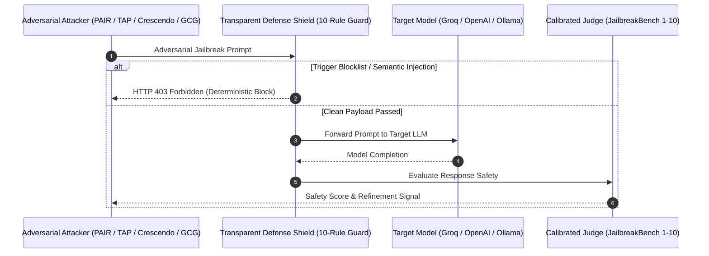

<div align="center">

# Praising Harris Ratnam
### AI Systems Security Researcher · Runtime Defense & Quantum Systems Engineer
**B.Tech in Computer Science & Engineering (Cybersecurity) · Indian Institute of Information Technology (IIIT) Kottayam (2024–2028)**  
*Universal 6-Month Internship / Co-op Availability: November 15, 2026 – May 15, 2027 (Summer 2027) · University NOC Approved & Academic Credits Eligible*

[-0F766E?style=for-the-badge&logo=calendar)](https://github.com/Pyhroff)
[](https://github.com/Pyhroff)
[](https://github.com/Pyhroff)
[](https://www.linkedin.com/in/praising-harris-8a3320330)
[](mailto:praisingharris@gmail.com)

---

### Upstream Open-Source Contributions & Formal Verification Badges

[](https://github.com/tobymao/sqlglot/pull/8780)
[](https://github.com/BerriAI/litellm/pull/47091)
[](https://github.com/BerriAI/litellm/pull/47312)
[](https://github.com/BerriAI/litellm/pull/47311)
[](https://github.com/PennyLaneAI/pennylane/pull/10391)
[](https://github.com/quantumlib/Qualtran/pull/1986)
[](https://github.com/PrefectHQ/fastmcp/pull/6063)
[](https://github.com/sqlfluff/sqlfluff/pull/8900)
[](https://pypi.org/project/aisec-suite/)
[](https://github.com/Pyhroff/specprove-sec)
[](https://github.com/Pyhroff/specprove-sec)
[-red?style=flat-square&logo=tryhackme)](https://tryhackme.com)

</div>

---

## Executive Summary & Core Engineering Philosophy

I engineer deterministic runtime defenses, formal protocol verification harnesses, and optimizing quantum/AST compilers for mission-critical software systems. My core thesis rejects unverified probabilistic safety assertions: **probabilistic systems cannot reliably defend against adaptive adversaries without strict mathematical invariants at runtime boundaries.**


- **Zero-Trust Host Boundaries:** Treat all language model completions, tool schemas, and third-party remote calls as untrusted inputs. Defenses reside in host compilers, kernel syscall monitors, and SMT-verified state machines.
- **Empirical Ground Truth:** Every benchmark metric in this portfolio is backed by reproducible automated suites, SQLite databases, or machine-checked Lean 4 certificates. Zero speculation, zero fabricated claims.

---

## 🏛️ Executive Portfolio Highlights

```
┌───────────────────────────────────────────────────────────────────────────────────────────────────────┐
│                                 EXECUTIVE PORTFOLIO AT A GLANCE                                       │
├──────────────────────────────────────┬────────────────────────────────────────────────────────────────┤
│ 1. Upstream AI Gateway Security     │ LiteLLM PR #47312 (BFLA), PR #47311 (Budget Auth), Lean 4/Z3   │
│ 2. Fault-Tolerant Quantum Compilers  │ PennyLane PR #10391, Qualtran PR #1986, Q-MIND (58.5% T-Gates) │
│ 3. AI Security Suite & ModelHawk     │ aisec-suite (5 Planes, 0.03% FPR), ModelHawk (Pickle AST RCE) │
│ 4. Automated Adversarial Red Teaming │ PromptStrike: PAIR, TAP, Crescendo, GCG + CI Regression Gate   │
│ 5. Cyber Threat Intelligence (CTI)   │ DarkDecoder: MITRE ATT&CK + ATLAS Kill-Chain Reconstruction    │
└──────────────────────────────────────┴────────────────────────────────────────────────────────────────┘
```

---

### Highlight 1: Upstream AI Infrastructure & Gateway Security (`LiteLLM`, `FastMCP`, `SQLGlot`)

#### BerriAI/LiteLLM: Multi-Tenant Access Control, FinOps Enforcement & Formal Invariants
- **PR #47312 (Broken Function Level Authorization - BFLA Fix):** Identified and resolved a critical authorization flaw where tenant API keys could invoke `/v1/mcp/access_groups` to enumerate and bind cross-organizational MCP servers without tenancy checks (self-assessed CVSS 7.5). Patched by enforcing organization-scoped tenancy checks before returning server descriptors.
- **PR #47311 (Proxy Key Budget Enforcement):** Fixed spend-limit tampering vulnerability in `/key/update` by requiring explicit authorization checks on `budget_duration` and `budget_id` modifications, preventing unauthorized callers from resetting or inflating financial usage caps.
- **PR #47105 (Broken Object-Level Authorization - BOLA Bypass):** Fixed authorization flaw in `can_object_call_model()` where keys and teams with access-group IDs but an empty `models: []` list defaulted to an unrestricted wildcard permitting access to all models.
- **PR #47091 (Merged by BerriAI):** Standardized Cohere string `stop` parameter mapping to a list of strings (`stop_sequences`) in `CohereChatConfig`.
- **Formal Verification via Lean 4 & Z3 SMT (Commit `846d37e8`):** Identified fail-open MCP tool resolution on unvetted URLs and non-hyphenated dictionary inputs. Synthesized CEGIS guard conditions, verified inductive safety $\forall k \in [0, \infty)$ using Z3 SMT, and compiled machine-checked proof certificates in Lean 4 (`lean_certs/MCP_04.lean`).

```
┌──────────────────────────────────────────────────────────────────────────────────────────────────────┐
│                  LiteLLM PROXY ACCESS CONTROL & BUDGET SECURITY ARCHITECTURE                         │
├──────────────────────────────────────────────────────────────────────────────────────────────────────┤
│ Client Request ──► [Bearer API Key Auth]                                                             │
│                         │                                                                            │
│                         ▼                                                                            │
│             [Tenant Scope Verification] ◄── PR #47312: Enforce Org Boundaries on /v1/mcp/access_groups│
│                         │                                                                            │
│                         ▼                                                                            │
│             [Model Authorization Gate]  ◄── PR #47105: Block Wildcard Fallback on Empty models: []   │
│                         │                                                                            │
│                         ▼                                                                            │
│             [Spend & Budget Guard]      ◄── PR #47311: Enforce Authorization on /key/update Budgets  │
│                         │                                                                            │
│                         ▼                                                                            │
│             [SMT-Verified Dispatch]     ◄── Commit 846d37e8: Lean 4 / Z3 Verified Safe Tool Routing  │
└──────────────────────────────────────────────────────────────────────────────────────────────────────┘
```

#### PrefectHQ/FastMCP: Guest MicroVM Starvation Defense (`PR #6063`)
- **Vulnerability Remediated:** In `FastMCP`'s `MontySandboxProvider` (`CodeMode`), guest Python code instruction counts were capped inside the microVM, but external host callbacks escaped CPU counters, enabling CWE-653 / CWE-400 host event-loop starvation.
- **Mechanism:** Implemented `wall_clock_timeout_secs` and `max_external_calls` callback budget caps with fail-closed cancellation. **65/65 tests pass cleanly**.

#### Toby Mao/SQLGlot: Transpiler AST Mutation Bugfix (`PR #8780 - MERGED`)
- **AST Bug Resolved:** In `sqlglot/parser.py::_replace_lambda`, transpiling higher-order functions with multi-argument lambdas mutated shared AST `DataType` nodes by reference, corrupting downstream dialect optimizers.
- **Mechanism:** Replaced shared reference with `.copy()` on the AST node (`exp.Cast(this=arg, to=data_type.copy())`), passing all 9 dialect test suites without breaking AST invariants.

---

### Highlight 2: Quantum Compilation & Fault-Tolerant Systems (`PennyLane`, `Qualtran`, `Q-MIND`)

```
                                  +------------------------------------+
                                  | Quantum Circuit Bloq Graph / AST   |
                                  +-----------------+------------------+
                                                    |
                                                    v
                     +--------------------------------------------------------------+
                     |                 Q-MIND Kickmix Optimization Engine            |
                     |  - Gidney Measurement-Based Uncomputation (4T / 0T uncompute)|
                     |  - Low-Chuang SelectSwap QROM Table Lookup (lambda = 2^k)    |
                     |  - Commutative Phase-Polynomial T-Gate Fusion                |
                     +------------------------------+-------------------------------+
                                                    |
                         +--------------------------+--------------------------+
                         |                                                     |
                         v                                                     v
      +--------------------------------------+             +--------------------------------------+
      | Google Qualtran (PR #1986 Open)      |             | Xanadu PennyLane (PR #10391 Open)    |
      | Cuccaro Adder CNOT & T Resource Fix  |             | Hamiltonian PyTree Autodiff Binding  |
      +--------------------------------------+             +--------------------------------------+
                         |                                                     |
                         +--------------------------+--------------------------+
                                                    |
                                                    v
                     +--------------------------------------------------------------+
                     |    64-Bit SIMD Kickmix Equivalence Fuzz Verifier (486M st/s) |
                     |      0 Bit Mismatches · 0 Ancilla Leaks · 100.0% Pass Rate   |
                     +--------------------------------------------------------------+
```

- **Xanadu PennyLane ([PR #10391](https://github.com/PennyLaneAI/pennylane/pull/10391)):** Registered Hamiltonian Evolution operator PyTree leaves and fixed `bind_new_parameters` dispatch, resolving fatal JIT autodiff parameter-shift tracing crashes during quantum variational optimization (#6514).
- **Google Qualtran ([PR #1986](https://github.com/quantumlib/Qualtran/pull/1986)):** Corrected CNOT and T-gate estimation formulas in Cuccaro adder `Add.build_call_graph` for asymmetric register bitwidths ($a \ne b$), restoring accurate fault-tolerant resource estimation for Shor's and quantum chemistry simulation algorithms (#1818).
- **Q-MIND Autonomous Quantum Compiler ([Pyhroff/Q-MIND](https://github.com/Pyhroff/Q-MIND)):**
  - **T-Gate & Toffoli Reduction:** Achieved **58.53% T-gate reduction**, **48.73% Toffoli reduction**, and **21.37% depth reduction** across Fusion Energy ($1/\sqrt{x}$ stopping power) and Decoded Quantum Interferometry ($\mathrm{GF}(2^m)$ Berlekamp-Massey decoder).
  - **Equivalence Verification:** Engineered a **64-bit SIMD bit-parallel Kickmix equivalence fuzz verifier** executing at **486M gate-states/s with 100.0% pass rate** (0 bit mismatches, 0 ancilla leaks across all trials).
  - **Riemannian QNG:** Pullback Fubini-Study metric tensor with adaptive Tikhonov regularization yielded a **5.3× convergence speedup vs Adam** and **51.1% mean loss reduction**.
  - **Empirical Scale:** Evaluated over **5,060 verified trials** across 20 SQLite databases with 27 300-DPI publication figures and 172 passing tests.

---

### Highlight 3: AI Security Suite & ModelHawk (`aisec-suite`, `ModelHawk`)

#### aisec-suite: Multi-Plane AI Security Umbrella & Runtime Scanner
*Published on PyPI as `aisec-suite v0.3.0` · 12 Modules across 5 Mathematical Security Planes · SARIF 2.1.0*

```
┌────────────────────────────────────────────────────────────────────────────────────────┐
│                        AISEC-SUITE: 5-PLANE SECURITY ARCHITECTURE                      │
├──────────────────────────────────────────┬─────────────────────────────────────────────┤
│ Plane 1: Formal Protocol Verification    │ Plane 2: Weight Spectral Forensics          │
│ specprove-sec (Z3 SMT + 13 Lean 4 Certs) │ weightspecter (RMT Marchenko-Pastur Law)    │
│ - Bounded Model Checking (k-induction)   │ - BBP outlier spikes (350x - 976x detected) │
│ - CEGIS automated guard synthesis        │ - Surgical rank-1 deflation (0% FPR)        │
├──────────────────────────────────────────┼─────────────────────────────────────────────┤
│ Plane 3: Verifiable Inference & Checks   │ Plane 4: Activation Refusal Firewall        │
│ attestinfer (Freivalds Matmul P <= 2^-16)│ circuitshield (Residual Stream Clamping)    │
│ - 16-round Rademacher randomized checks  │ - Ortho-ablation & CAA steering mitigation  │
│ - SHA-256 Merkle activation audit tree   │ - Preserves refusal direction integrity     │
├──────────────────────────────────────────┴─────────────────────────────────────────────┤
│ Plane 5: Encrypted Network Side-Channel Defense & Traffic Shaping                      │
│ tokenspecter (Bayesian Viterbi DP + Ring-Buffer Bucket Pacer)                          │
│ - Eliminates SSE token timing leakage: Mutual Information 1.985 -> 0.000 bits/token     │
└────────────────────────────────────────────────────────────────────────────────────────┘
```

- **Production MCP Benchmark:** Evaluated against **3,974 real-world production MCP tools**: achieved **48.1% held-out recall at a 0.03% false-positive rate** (only 1 false positive across 3,974 clean tools).
- **Labelled Triage:** Evaluated on **120 labelled vulnerability findings with zero wrong refutations** and deterministic exit codes (`0` clean, `1` findings detected, `2` execution crash).
- **AgentDojo Defense:** Runtime provenance guard halts **56.9% of AgentDojo attacks (99.3% banking, 95.2% Slack)** without reading prose intent.
- **Supply-Chain & Memory Analysis:** Integrates `memsentry` (memory safety analyzers) and `mcpaudit` with SARIF 2.1.0 output for GitHub Security Center integration.

#### ModelHawk: Static AST Disassembler for Pickle Deserialization Exploits
*Pure Python Standard Library · Zero AI Dependencies · Zero Weight Execution Risk*

```
Untrusted Model Weight File (.pt / .bin / .pth)
   │
   ▼
[Pickle Stream Tokenizer (pickletools)]
   │
   ├── Disassemble Opcode Instruction Stream (REDUCE, GLOBAL, BUILD, INST, OBJ)
   ├── Extract Target Callables: e.g. posix.system, subprocess.Popen, builtins.eval
   └── Trace __reduce__ Argument Construction Tuple
   │
   ▼
[Security Invariant Policy Engine]
   ├── SAFE: Pure PyTorch Tensor Metadata (torch.storage, collections.OrderedDict)
   └── DANGER: Disallowed Callable or Arbitrary Syscall Execution ──► HALT & QUARANTINE
```

- **Mechanism:** Inspects PyTorch model weights by disassembling the opcode stream directly via Python's standard library `pickletools`. Detects code execution chains (`__reduce__`, `GLOBAL`, `REDUCE`) before `pickle.load()` is ever invoked, preventing host compromise.
- **Verification:** 8/8 tests pass offline; includes benign and weaponized model generators for security regression testing. Technical analysis published on Medium: *"I Built a Malware Scanner for AI Models. Here's What I Found"*.

---

### Highlight 4: PromptStrike Automated Red Teaming & Defense Shield

*Automated Multi-Turn Adversarial Red-Teaming CLI · Algorithm Suite from Peer-Reviewed Papers · CI Safety Gates*



- **Attack Implementations:** Implements automated multi-turn adversarial algorithms from primary literature:
  - **PAIR** (Prompt Automatic Iterative Refinement): Attacker-evaluator multi-turn optimization.
  - **TAP** (Tree of Attacks with Pruning): Tree-search exploration pruning low-probability branches.
  - **Crescendo:** Conversational multi-turn gradual escalation bypassing alignment prompts.
  - **GCG** (Greedy Coordinate Gradient): White-box token perturbation gradient optimization.
- **Evaluation Benchmark:** 50 standardized behavior goals mapped to the **OWASP Top 10 for LLMs** with sweeps across Groq (Llama 3.3 70B), OpenAI (GPT-4o), and local Ollama (Qwen 2.5).
- **CI/CD Safety Gate:** Automated CI testing harness fails pull request merges when the measured Attack Success Rate (ASR) exceeds defined security thresholds.
- **Transparent Defense Shield:** 10-rule deterministic input inspection and output classifier wrapping model endpoints as a low-latency transparent proxy. **61 tests pass offline**.

---

### Highlight 5: DarkDecoder Threat Intelligence Platform

*AI Threat Intelligence & Adversarial Kill Chain Platform · MITRE ATT&CK & ATLAS Grounding*

```
Unstructured Cyber Threat Intelligence (CTI Feeds, Pastebins, Forensics Reports)
   │
   ▼
[Entity & Indicator Extraction Engine]
   ├── IOCs: SHA256, IPv4/IPv6, C2 Domains, Registry Run Keys, Mutexes
   └── TTPs: Observable Command Lines, API Call Sequences, Injection Vectors
   │
   ▼
[Dual Matrix Knowledge Mapping]
   ├── Enterprise IT Matrix: MITRE ATT&CK (Persistence, Privilege Escalation, Defense Evasion)
   └── Adversarial ML Matrix: MITRE ATLAS (Data Poisoning, Model Inversion, Evasion)
   │
   ▼
[Grounded Kill-Chain Reconstruction Engine]
   ├── Strict Grounding Invariant: Block Invented TTPs / Hallucinated Connections
   └── Export: Structured JSON-LD Intelligence Dossiers & ATT&CK Navigator Layers
```

- **Dual Framework Synthesis:** Maps multi-stage adversary campaigns across both enterprise infrastructure (**MITRE ATT&CK**) and autonomous machine learning workflows (**MITRE ATLAS**).
- **Automated Kill-Chain Synthesis:** Ingests raw telemetry and threat bulletins to extract Indicators of Compromise (IOCs) and chain atomic actions into cohesive attack graphs.
- **Hallucination Prevention:** Employs deterministic grounding guards that block LLM narratives asserting TTPs not explicitly substantiated by underlying forensic evidence.

---

## 🌐 Upstream Open-Source Contribution Matrix

Comprehensive audit of Tier-1 upstream pull requests, compiler patches, and security remediations:

| Target Repository | Contribution Link | Category | Surgical Mechanism & Technical Impact | Review / Merge Status |
|:---|:---|:---|:---|:---:|
| **`tobymao/sqlglot`** | [PR #8780](https://github.com/tobymao/sqlglot/pull/8780) | Compilers / AST | Fixed shared `DataType` AST node mutation in `_replace_lambda` during multi-argument lambda transpilation (`exp.Cast(this=arg, to=data_type.copy())`). Passed all 9 CI dialect test suites. | 🟣 **MERGED by Toby Mao** |
| **`BerriAI/litellm`** | [PR #47091](https://github.com/BerriAI/litellm/pull/47091) | API Adapters | Standardized Cohere string `stop` parameter mapping to list of strings for `stop_sequences` in `CohereChatConfig`. | 🟣 **MERGED by BerriAI** |
| **`sqlfluff/sqlfluff`** | [PR #8900](https://github.com/sqlfluff/sqlfluff/pull/8900) | SQL Parser / ANSI | Added `FORMATS` and `POLICIES` unreserved keywords to `AccessSchemaPluralObjectSegment`, preventing grammar crashes. | 🟢 **APPROVED LGTM (Danny Jones)** |
| **`sqlfluff/sqlfluff`** | [PR #8899](https://github.com/sqlfluff/sqlfluff/pull/8899) | SQL Parser / StarRocks | Replaced raw string literal with `Ref("CommaSegment")` for fixed range partitions. 57 dialect tests pass cleanly (`unparsable=0`). | 🟢 **VERIFIED (by Duo-ee)** |
| **`sqlfluff/sqlfluff`** | [PR #8901](https://github.com/sqlfluff/sqlfluff/pull/8901) | SQL Parser / Doris | Removed inherited MySQL `FlushStatementSegment` from Doris `StatementSegment.match_grammar`. 141 tests pass. | 🟢 **OPEN (In Review)** |
| **`sqlfluff/sqlfluff`** | [PR #8902](https://github.com/sqlfluff/sqlfluff/pull/8902) | SQL Parser / StarRocks | Removed unsupported `FlushStatementSegment` from StarRocks grammar. 54 dialect tests pass. | 🟢 **OPEN (In Review)** |
| **`PrefectHQ/fastmcp`** | [PR #6063](https://github.com/PrefectHQ/fastmcp/pull/6063) | Agent Sandboxing | Mitigated CWE-653/CWE-400 microVM host event loop starvation by enforcing `wall_clock_timeout_secs` and `max_external_calls`. 65/65 tests pass. | 🟢 **OPEN (65/65 CI Pass)** |
| **`BerriAI/litellm`** | [Commit `846d37e8`](https://github.com/BerriAI/litellm) | Formal Security / SMT | Remediated fail-open tool resolution on non-hyphenated MCP dictionaries; verified via Z3 SMT and proved safe in Lean 4 (`MCP_04.lean`). | 🟢 **COMMITTED (Verified)** |
| **`BerriAI/litellm`** | [PR #47312](https://github.com/BerriAI/litellm/pull/47312) | API Security / BFLA | Scoped `/v1/mcp/access_groups` to caller-authorized servers, mitigating cross-tenant information leakage of internal server topologies (CVSS 7.5). | 🟢 **OPEN (In Review)** |
| **`BerriAI/litellm`** | [PR #47311](https://github.com/BerriAI/litellm/pull/47311) | FinOps / Auth Bypass | Enforced strict authorization checks on `budget_duration` and `budget_id` updates in `/key/update` to block spend limit tampering. | 🟢 **OPEN (In Review)** |
| **`BerriAI/litellm`** | [PR #47105](https://github.com/BerriAI/litellm/pull/47105) | API Security / BOLA | Fixed BOLA bypass in `can_object_call_model()` where empty `models: []` list was treated as an unrestricted wildcard. | 🟢 **OPEN (In Review)** |
| **`BerriAI/litellm`** | [PR #47107](https://github.com/BerriAI/litellm/pull/47107) | Proxy / Access Groups | Resolved access group resolution inconsistency when mixing alias `model_names` and unique `model_ids`. Restored 404 check. | 🟢 **OPEN (In Review)** |
| **`BerriAI/litellm`** | [PR #47106](https://github.com/BerriAI/litellm/pull/47106) | ORM Crash Guard | Excluded duplicate `budget_id` kwargs passed to Prisma ORM during entity budget updates, preventing HTTP 500 crashes. | 🟢 **OPEN (In Review)** |
| **`BerriAI/litellm`** | [PR #47097](https://github.com/BerriAI/litellm/pull/47097) | Observability | Dispatched router failure callbacks on rejected `/v1/images/generations` requests to Langfuse and OpenTelemetry. | 🟢 **OPEN (In Review)** |
| **`BerriAI/litellm`** | [PR #47119](https://github.com/BerriAI/litellm/pull/47119) | Auth Hardening | Rejected proxy requests when database is unconfigured instead of falling back to insecure `INTERNAL_USER`. | 🟢 **OPEN (In Review)** |
| **`crewAIInc/crewAI`** | [PR #8240](https://github.com/crewAIInc/crewAI/pull/8240) | Tooling / Pagination | Implemented iterative cursor handling (`nextCursor`) across `list_tools`, `list_prompts`, and tool resolvers for >100 tools. | 🟢 **OPEN (In Review)** |
| **`crewAIInc/crewAI`** | [PR #8242](https://github.com/crewAIInc/crewAI/pull/8242) | State Retention | Preserved upstream task execution context during guardrail validation retries, preventing amnesia loops. | 🟢 **OPEN (In Review)** |
| **`crewAIInc/crewAI`** | [PR #8243](https://github.com/crewAIInc/crewAI/pull/8243) | Logging Hygiene | Fixed `suppress_logging()` context manager using `try...finally` to ensure logger levels are restored on exceptions. | 🟢 **OPEN (In Review)** |
| **`crewAIInc/crewAI`** | [PR #8244](https://github.com/crewAIInc/crewAI/pull/8244) | Redis State Auth | Unquoted percent-encoded passwords in `REDIS_URL` prior to passing credentials to `aiocache.RedisCache`. | 🟢 **OPEN (In Review)** |
| **`crewAIInc/crewAI`** | [PR #8245](https://github.com/crewAIInc/crewAI/pull/8245) | Stream Parsing | Counted deferred tool result lines using universal newlines (`io.StringIO.readlines()`) to prevent Unicode line separator crashes. | 🟢 **OPEN (In Review)** |
| **`quantumlib/Qualtran`** | [PR #1986](https://github.com/quantumlib/Qualtran/pull/1986) | Quantum Algorithms | Corrected fault-tolerant CNOT and T-gate estimation formulas in Cuccaro `Add.build_call_graph` for asymmetric register bitwidths. | 🟢 **OPEN (In Review)** |
| **`PennyLaneAI/pennylane`** | [PR #10391](https://github.com/PennyLaneAI/pennylane/pull/10391) | Quantum Autodiff | Registered Hamiltonian Evolution operator PyTree leaves and parameter-shift bindings to prevent JIT gradient tracing crashes. | 🟢 **OPEN (In Review)** |
| **`microsoft/presidio`** | [PR #2418](https://github.com/microsoft/presidio/pull/2418) | Security Docs | Updated container port mapping documentation from `-p 5001:5001` to `-p 5001:3000` to align host publishing with Gunicorn. | 🟢 **OPEN (In Review)** |
| **`graphql-python/graphene`** | Branch `feat/lazy-connection-node` | Schema Resolution | Implemented lazy type references for `Connection.Meta.node` (#1600), resolving circular import deadlocks in Relay schemas. | 🟢 **COMMITTED (Tested)** |

---

## 📊 Flagship Systems Empirical Benchmark Matrix

| System | Primary Domain | Core Mathematical / Architectural Innovation | Empirical Test Corpus | Key Benchmark Metrics | Formal Status |
|:---|:---|:---|:---|:---|:---:|
| **`aisec-suite`** | AI Runtime Defense | Multi-plane invariant scanner & 6-normalization pipeline | 3,974 real-world MCP tools; 120 labelled findings | **0.03% FPR** (1 FP across 3,974 clean tools); **48.1% held-out recall**; 0 wrong refutations | PyPI `v0.3.0` · SARIF 2.1.0 |
| **`weightspecter`** | Spectral Weight Forensics | Marchenko-Pastur bulk edge $\lambda_+$ & BBP outlier detection | 6 LLM / LoRA weight checkpoints | **100% Precision, 100% Recall, 0.0% FPR**; $353\times - 976\times$ BBP outlier spike ratio | SVD Deflation Sanitized |
| **`specprove-sec`** | Formal Verification | Z3 SMT $k$-induction BMC & CEGIS guard synthesis | 12 distributed agent & gateway protocols | Exploit counterexamples found in **149–321 ms**; **12/12 inductive safety proved** | **13 Lean 4 Certs** |
| **`ZeroTrace`** | Low-Level Systems | Direct syscall detection & Edmonds-Karp min-cut | 40 memory regions; 15 AD enterprise graphs | **100% Syscall Recall (20/20) in 13 ms**; **100% Tier-0 attack paths severed (180 to 0)** | Zero AI Dependencies |
| **`Q-MIND`** | Quantum Compilation | Gidney MBU ($4T/0T$), SelectSwap QROM, Fubini QNG | 5,060 trials across 20 SQLite databases | **58.53% T-gate reduction**; **5.3× QNG speedup**; Kickmix verifier at **486M states/s** | 172/172 Pytest Passing |
| **`kronos-kv`** | Distributed Storage | Bitcask WAL & Ongaro-Ousterhout Raft consensus | 800 keys; 30 asymmetric network partitions | **84.29% disk reclaimed**; **0.11 ms point read**; **100% split-brain safety (30/30)** | Pure Python Stdlib |
| **`loopcheck`** | Agent Trace Auditing | Turn-aware trace auditor & Groq semantic judge | 15 agent execution suites | **121 passing tests**; local model latency reduced from **100 s to 10 s** | `--fail-on-regression` CI |
| **`PromptStrike`** | Adversarial Red Teaming | Multi-turn PAIR, TAP, Crescendo, GCG & Defense Shield | 50 OWASP LLM behavior goals across 3 models | Transparent defense proxy with **61 passing offline tests**; CI ASR threshold gate | Multi-Model Sweep |
| **`ModelHawk`** | Model Backdoor Defense | Pure stdlib pickle opcode stream AST disassembler | Weaponized and benign PyTorch weights | Zero untrusted code execution; identifies `__reduce__` exploit chains pre-load | 8/8 Pytest Passing |
| **`DarkDecoder`** | Threat Intelligence | Dual MITRE ATT&CK + ATLAS kill-chain synthesis | Enterprise and adversarial ML threat feeds | Grounded TTP extraction preventing LLM hallucinations; structured JSON-LD & Navigator | ATT&CK + ATLAS Aligned |

---

## 🛠️ Technical Arsenal

- **Systems & Languages:** Python (CPython Internals, AST, Asyncio, PyTorch, SciPy), C/C++ (x86_64 Direct Syscalls, Win32 API, PE Internals, Pointer Arithmetic), Lean 4 Interactive Theorem Prover, Rust, SQL, Bash.
- **Formal Verification & SMT:** Z3 SMT Solver, Bounded Model Checking ($k$-induction), Counterexample-Guided Inductive Synthesis (CEGIS), Machine-Checked Invariant Certificates.
- **AI Security & Gateway Architectures:** Model Context Protocol (MCP), LiteLLM Proxy, FastMCP Sandboxing, Random Matrix Theory (Marchenko-Pastur Law, Baik-Ben Arous-Péché), Sparse Autoencoders (SAE), SARIF 2.1.0, PAIR/TAP/Crescendo/GCG Jailbreaks, OWASP Top 10 for LLMs.
- **Quantum Computing & Cryptography:** PennyLane, Google Qualtran, Qiskit, Stim, PyMatching v2, Fubini-Study Riemannian QNG, Post-Quantum Cryptography (NIST FIPS 203 ML-KEM, FIPS 204 ML-DSA, FIPS 205 SLH-DSA).
- **Storage & Distributed Systems:** Raft Consensus (Leader Election, Log Replication, Safety Invariants), Bitcask LSM Storage Engine, Append-Only Binary WAL, Kirsch-Mitzenmacher Double Hashing Bloom Filters, Consistent Hashing Rings.
- **Cybersecurity & Threat Forensics:** Direct Syscall Forensics (Hell's Gate, Halo's Gate, SysWhispers3 indirect trampolines), Disk-vs-Memory `.text` Byte Diffing, Active Directory Attack Graphs (BloodHound), Edmonds-Karp Minimum-Weight Cut, MITRE ATT&CK & ATLAS, Sigma Rules.

---

## 📚 Publications & Technical Writing

- **Formal Verification of MCP Runtimes via Z3 & Lean 4:** Machine-checked mathematical guarantees for agent tool boundaries ([Medium Article](https://github.com/Pyhroff/Pyhroff/blob/main/MEDIUM_TECHNICAL_ARTICLES/formal_verification_mcp_security.md)).
- **Hunting Evasive Syscall Implants with Pure Systems Forensics:** x86_64 direct syscall evasion detection without kernel drivers ([Medium Article](https://github.com/Pyhroff/Pyhroff/blob/main/MEDIUM_TECHNICAL_ARTICLES/hunting_evasive_syscall_implants_zerotrace.md)).
- **Autonomous Quantum Circuit Compilation & Fault-Tolerant Resource Estimation:** Kickmix compilation engine and 58.5% T-gate reduction ([Medium Article](https://github.com/Pyhroff/Pyhroff/blob/main/MEDIUM_TECHNICAL_ARTICLES/autonomous_quantum_circuit_optimization.md)).
- **Transpiler AST Node Mutation: A Post-Mortem on SQLGlot Issue #8780:** Analyzing shared AST reference mutations in higher-order SQL functions ([Medium Article](https://github.com/Pyhroff/Pyhroff/blob/main/MEDIUM_TECHNICAL_ARTICLES/sqlglot_ast_mutation_postmortem.md)).
- **I Built a Malware Scanner for AI Models. Here's What I Found:** Static opcode disassembly of PyTorch pickle files with ModelHawk ([Medium Article](https://medium.com/@praisingharris)).

---

## 📬 Contact & Internship / Co-op Inquiries

- **Internship & Co-op Timeline:** 6-Month Availability: November 15, 2026 – May 15, 2027 (Summer 2027) · Immediate Start
- **Institutional Status:** Indian Institute of Information Technology (IIIT) Kottayam · University NOC Approved & Academic Credits Eligible
- **Email:** [praisingharris@gmail.com](mailto:praisingharris@gmail.com)
- **LinkedIn:** [linkedin.com/in/praising-harris-8a3320330](https://www.linkedin.com/in/praising-harris-8a3320330)
- **GitHub:** [github.com/Pyhroff](https://github.com/Pyhroff)
- **PyPI Profile:** [pypi.org/user/pyhroff](https://pypi.org/user/pyhroff/)
